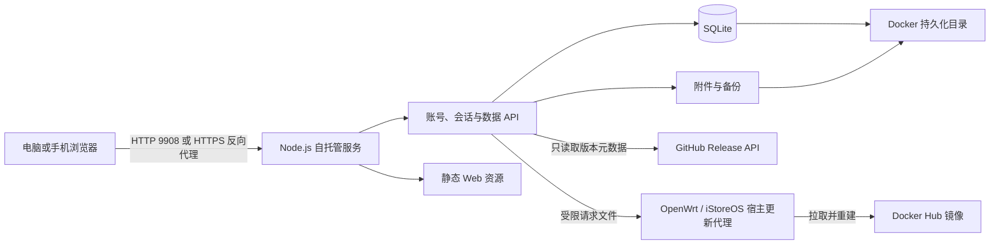

# 架构说明

## 系统结构



| 层 | 实现 |
|---|---|
| 前端 | Vite、统一 TypeScript 启动入口、渐进迁移中的 Vue 3 / TypeScript / Pinia、Tiptap 3、ProseMirror、DOMPurify、fflate；`src/api/` 按领域封装同源请求和响应契约 |
| 服务端 | Node.js 24 HTTP 服务（容器内固定监听 9908）；`server/config.mjs` 在启动前集中解析配置并校验可信代理名单，API 入口统一执行来源与会话校验；认证、账号、附件、备份和知识库用例由应用服务编排，Repository 承担 SQLite 读写 |
| 共享领域 | `shared/` 保存浏览器与服务端共用的知识库、书签校验规则和 API 请求/响应契约；HTTP 错误映射留在服务端边界 |
| 数据库 | Node 内置 SQLite，WAL 模式、同步事务和顺序迁移 |
| 镜像 | `luckyalanzhou/qidian`，支持 `linux/amd64` 与 `linux/arm64` |
| iStoreOS 24.10 / 25.12 与兼容的 OpenWrt | `.run` 自解压安装器部署 LuCI、Compose、管理脚本和受限更新代理，不调用系统包管理器 |

正式入口是 `index.html`。前端代码位于 `src/`，服务端位于 `server/`，数据库迁移位于 `migrations/`。`private_wiki_prototype.html` 只作为原始设计基线，不参与构建。

## 架构演进状态

当前采用单体部署、模块化代码边界。前后端共享一个镜像和同源 API，避免引入独立服务后增加部署和维护负担。迁移按功能逐块进行，旧界面与 API 路径在对应模块完成替换前继续工作。

## 数据目录

容器内统一使用 `/data`：

```text
/data/
├── qidian.sqlite
├── qidian.sqlite-wal / qidian.sqlite-shm   运行时文件
└── migration-backups/                      结构迁移前的数据库副本
```

iStoreOS 将当前设备 Docker Root Dir 下的 `volumes/qidian/data` 挂载到 `/data`。通用 Docker 将 `qidian-data` 命名卷挂载到 `/data`。路径由部署端决定，应用代码不写死宿主目录。iStoreOS 的宿主更新请求目录单独保存在 `/opt/qidian/update-control`，不与容器可写数据卷共享。

SQLite 启动参数包含外键、5 秒 busy timeout、WAL 和 FULL synchronous。服务启动时按文件名顺序执行尚未应用的迁移；迁移前复制数据库到 `migration-backups`。旧的单人表与早期认证字段保留，是为了兼容已有设备升级，不能作为“未使用文件”删除。

## 账号与会话

客户端使用 PBKDF2-HMAC-SHA-256 派生登录验证值，随机盐和迭代参数由服务端挑战决定。服务端保存派生结果，不保存明文密码。

- 密码派生迭代次数：600,000。
- 会话期限：连续 3 天未使用后失效，登录满 7 天强制重新验证；活动期限最多每小时续期一次。
- Cookie：`qidian_session`、HttpOnly、SameSite=Strict；HTTPS 请求额外设置 Secure。
- 登录、注册和更新操作包含 Origin 检查与请求频率限制。
- 所有账号数据通过 `account_id` 隔离。
- 修改或重置密码时删除该账号的其他会话。

第一次自托管启动且数据库没有账号时，状态接口允许创建首个管理员。管理员创建完成后，注册由 `REGISTRATION_ENABLED` 控制。LuCI 只读取“等待创建管理员/管理员已创建”状态，不读取账号和密码。

## 保存与多设备

前端编辑停止约 250 毫秒后把当前知识库加入串行保存队列。保存请求携带 SQLite revision；服务端只有在 revision 匹配并完成事务后才返回成功。界面不会把“进入队列”显示成保存成功。

前台页面每 2.5 秒读取轻量 revision，重新进入前台时立即检查。revision 改变后才下载完整知识库：

1. 不同笔记、不同字段和不重叠正文修改自动合并。
2. 合并结果先更新当前内存，再以最新 revision 写回。
3. 同一段内容发生重叠修改时停止自动覆盖，保留本机和服务端两个版本。
4. 用户先下载冲突对照 ZIP，再明确选择恢复服务端版本或继续处理本机版本。

生产模式不把正文作为长期副本写入浏览器。网络失败时只保留当前页面内存和必要的一次恢复槽，服务恢复后重试。

## 编辑与内容安全

Tiptap JSON 是粘贴和编辑过程中的统一结构，SQLite 中继续保存经过清理的 HTML。Markdown 通过 `@tiptap/markdown` 转成 JSON，再经过允许节点、属性和 URL 规则清理。兼容纯文本整理器只在用户选择对应模式时使用，避免两套解析器重复插入。

DOMPurify 和服务端校验共同阻止脚本、事件属性、表单、iframe、危险协议和越权附件地址。远程图片使用原 URL，不自动下载；本地图片通过鉴权附件 API 分块写入 SQLite。

当前限制：

- 附件上传、存储和下载没有应用层单文件或累计容量上限。附件经固定大小分块写入 SQLite，并逐块下载；实际能力受宿主机数据卷、文件系统、SQLite，以及反向代理可能配置的请求体大小和连接超时限制。服务端按普通进程可用空间计算数据卷所在文件系统使用率，超过 70% 时已登录工作区显示持续提醒，不阻断保存或上传。
- 完整 ZIP 备份不设应用层文件或附件累计字节上限，但仍整包读入内存；大体积归档能力受 ZIP 格式、运行时内存和客户端资源限制，手机端峰值内存与响应性尚未验证。不能把无应用配额等同于任意体量都可在所有设备上处理。
- 每账号知识库序列化数据不超过 1,000,000 UTF-8 字节（约 0.95 MiB），计入笔记、书签、回收站和偏好设置，不计入附件。
- 单篇正文与已发布快照正文长度不超过 1,000,000 个 JavaScript 字符，按 JavaScript 字符串长度校验。
- 书签和分组合计 10,000，层级最多 32。

## 历史与备份

SQLite 触发器在数据更新前保存正文快照，每分钟最多一个，按创建时间保留最近 20 个。完整 ZIP 由前端读取已鉴权的知识库和附件后生成，包含 `vault.json` 与原始附件。完整导入和历史恢复前，客户端先确认待保存内容已完成 SQLite 事务，再下载完整 ZIP 并请求服务端保留当前快照。单篇 HTML 导出会尽可能内嵌本地附件；远程资源仍依赖原站。

附件清理只删除当前知识库和保留快照都未引用的当前账号附件；删除账号、清理其他账号或绕过鉴权均不在该接口能力范围内。

正文快照、ZIP 导出和宿主目录备份用途不同。设备迁移或删除数据卷前，应同时导出 ZIP 并复制整个持久化目录。

## 版本检查与在线更新

已登录用户可读取当前版本和固定仓库的最新稳定 Release；只有首个账号可以提交设备更新。

容器不挂载 Docker Socket。更新流程使用两个受控挂载目录：

- 容器可写请求目录，只能创建固定的 `update-request` 文件。
- 容器只读状态目录，用来读取状态和最近 64 KiB 日志。

OpenWrt / iStoreOS 宿主代理由 procd 管理，处理步骤如下：

1. 从固定 GitHub 仓库读取最新 Release。
2. 下载带版本号的 `.run` 及 `.sha256`。
3. 校验 SHA-256 与版本号。
4. 更新 LuCI 和宿主管理文件。
5. 等待 10 秒，拉取适合当前架构的 Docker Hub 镜像。
6. 使用设备锁重建容器并确认目标版本健康。
7. Web 确认目标版本在线后倒计时 5 秒并刷新页面。

更新请求、状态和日志由 iStoreOS 宿主代理保存在宿主安装目录的 `update-control` 下：请求位于 `inbox`，状态文件与最近日志位于 `outbox`。默认安装目录为 `/opt/qidian`，因此日志路径为 `/opt/qidian/update-control/outbox/update.log`。它不属于 Docker 数据目录。历史成功状态不能代替本次任务结果，Web 必须确认当前目标版本已经运行。

## 网络边界

默认 HTTP 9908 只适合可信局域网。公网访问应使用 HTTPS 反向代理，设置 `TRUST_PROXY=true`，并用 `TRUSTED_PROXY_IPS` 限定直接代理地址。代理必须重写 `X-Forwarded-Proto`、`X-Forwarded-Host` 和 `X-Forwarded-For`，同时阻止公网直接访问容器端口。

版本检查会访问 GitHub，镜像安装和更新会访问 Docker Hub；知识库正文、附件和账号数据不会发送到这些服务。公网访问的 TLS、域名和端口转发由部署环境负责。
